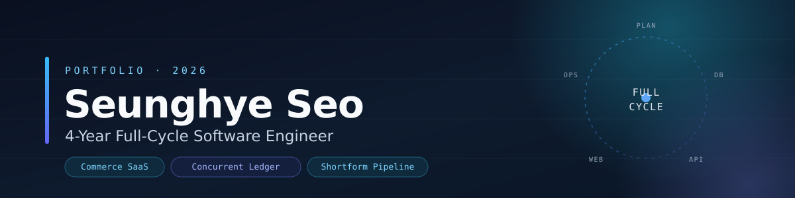
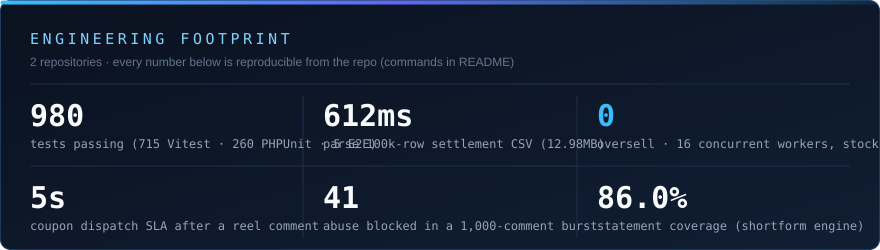

<div align="center">
  

  <h1>Hi there, I'm Seunghye Seo 👋</h1>
  <h3>4-Year Full-Cycle Software Engineer</h3>

  <p>
    <b>커머스 SaaS, 고동시성 선착순 원장, 숏폼 발행 파이프라인, 공공데이터 수집·지표 파이프라인을 만드는 1인 풀사이클 개발자</b><br />
    기획 → DB 설계(MySQL · PostgreSQL) → 백엔드(PHP 8.2 · Node.js) → 프론트엔드(TypeScript · Next.js · React) → 운영·관측까지, 한 사람이 끝까지 책임집니다.
  </p>

  <p>
    
    
    
    
    
  </p>

  <p>
    <a href="#-flagship-projects">Flagship Projects</a> ·
    <a href="#-full-cycle--한-사람이-끝까지">Full-Cycle</a> ·
    <a href="#-tech-stack">Tech Stack</a> ·
    <a href="#-github-stats">GitHub Stats</a> ·
    <a href="#-contact">Contact</a>
  </p>
</div>

---

## 💡 무엇을 만드는가

이커머스와 콘텐츠 운영에서 **돈이 새는 지점**을 코드로 막는 일을 합니다. 화면을 예쁘게 만드는 것으로는 증명되지 않는 문제 — 재고 경합, 정산 불일치, 플랫폼 쿼터, 어뷰징 — 를 숫자로 재현하고 테스트로 고정합니다.

| 문제 | 실제로 벌어지는 일 | 제가 만든 답 |
| --- | --- | --- |
| **선착순 재고 경합** | 재고 100건에 1,000건 동시 요청 인입 시 초과 발급 발생 | `SELECT … FOR UPDATE` + 버전 낙관적 락 · 멱등 키, 워커 16개 동시 경합에서도 오버이슈 0건 실측 |
| **정산서 불일치** | "매출은 늘었는데 통장에 들어온 정산금은 줄었다" | 계약 조건 기반 자동 재계산으로 원인별 불일치 금액 증명 (수수료 초과 · 반품비 중복 · 역마진) |
| **숏폼 운영 확장** | 대량 예약 작업 인입 시 대기열 병목 및 지연 발생 | 우선순위 큐 + `SKIP LOCKED` 선점 + DLQ 격리, 플랫폼 쿼터(25건/일) 사전 검증 |
| **이벤트 어뷰징** | 댓글 이벤트에 매크로 · 다계정 동시 유입 | 디바이스 지문 · 버스트 판정으로 1,000건 부하 중 어뷰징 41건 차단, 1회용 HMAC 토큰 |
| **공공데이터 재수집 중복** | 같은 달 실거래가를 다시 받을 때 표기 차이로 행이 늘어 집계가 왜곡 | 정규화 후 `sha256` 거래 해시 + `ON CONFLICT DO UPDATE`, 신규/갱신 카운트 분리 |
| **부분 실패** | 6개 지역·월 배치 중 1개만 실패했을 때 전체 재수집 또는 누락 | 실행/배치를 나눠 `succeeded · partial · failed` 상태와 DLQ로 어느 배치가 빠졌는지 남김 |

---

## 🚀 Flagship Projects

<table>
<tr>
<td width="50%" valign="top">

<h3><a href="https://github.com/Shye-Seo/commerce-seller-analytics">1. SellerScope</a></h3>

<b>이커머스 정산 대사 &amp; 마진 분석 플랫폼</b><br />
<sub><code>Next.js 14</code> <code>TypeScript</code> <code>PHP 8.2</code> <code>MySQL 8.0</code> <code>Web Worker</code></sub>

<p>마켓이 준 정산서를 <b>계약 조건으로 다시 계산</b>해서, 셀러가 실제로 얼마를 잘못 받았는지 <b>원인별 금액으로 증명</b>합니다.</p>

<p>
• <b>10만 행(12.98MB) 정산서 스트리밍 파싱 612ms</b>, 대사 계산 161ms<br />
• 10만 행 × 13열 = 130만 셀 → <b>390 DOM 노드</b>로 가상화 (약 3,300배 절감)<br />
• <b>재고 1,000 · 워커 프로세스 16개 동시 경합 → 발급 1,000건 · 오버이슈 0건</b><br />
• 쿠폰 원장 <b>10만 행</b> 적재 25.3s, 멱등키 조회 <b>0.29ms</b> — 인덱스 실행계획까지 측정<br />
• 의존성 0의 <b>XLSX 파서</b>(ZIP + <code>DecompressionStream</code>), 마켓별 규격 CSV · 인쇄용 PDF 소명 리포트<br />
• <b>테스트 545</b> — Vitest 400 · PHPUnit 135 · Playwright E2E 10<br />
• <b>월별 재대사</b> — 월 요약 이력 저장 + 전월 대비 원인별 차액·신규/해소 판정
</p>

<p>
<a href="https://github.com/Shye-Seo/commerce-seller-analytics">저장소</a> ·
<a href="https://github.com/Shye-Seo/commerce-seller-analytics/blob/main/database/ERD_SPEC.md">ERD 설계서</a> ·
<a href="https://github.com/Shye-Seo/commerce-seller-analytics/blob/main/docs/settlement-reconciliation-spec.md">대사 명세</a>
</p>

</td>
<td width="50%" valign="top">

<h3><a href="https://github.com/Shye-Seo/sns-shortform-automation">2. shortform-engine</a></h3>

<b>숏폼 제작 · 배포 자동화 파이프라인</b><br />
<sub><code>TypeScript</code> <code>Node.js 20</code> <code>PHP 8.2</code> <code>Redis</code> <code>ffmpeg</code> <code>Meta Graph API</code></sub>

<p>영상 1편을 제작하는 단계를 넘어, 다수 테넌트의 대규모 예약 발행을 안정적으로 처리하는 분산 인프라를 구축했습니다.</p>

<p>
• 릴스 댓글 → <b>5초 안에 1회용 딥링크 쿠폰</b> (HMAC-SHA256 서명 · 1회용 · 만료 검증)<br />
• 1,000건 동시 인입 부하 실측: <b>어뷰징 41건 차단 · 발송 500 · 수령 349 · 오버이슈 0건</b><br />
• 분산 렌더 큐: <code>SKIP LOCKED</code> 선점 · Lease 장애 복구 · <b>DLQ 원클릭 재시도 콘솔</b><br />
• Meta 25건/일 · YouTube 1,600 unit 등 <b>플랫폼별 일일 API 쿼터 사전 계산 및 초과 차단</b><br />
• 오디오 더킹 · 단어별 키네틱 자막 · 9:16 안전영역 · FFmpeg 6.0 실렌더 검증<br />
• <b>쿼터 인지 발행 계획</b> — 예산이 없으면 실패가 아니라 다음 창으로 미루고, 슬롯·최소 간격·우선순위를 함께 지킴<br />
• <b>테스트 586</b> — Vitest 461 · PHPUnit 125, 커버리지 86.0%
</p>

<p>
<a href="https://github.com/Shye-Seo/sns-shortform-automation">저장소</a> ·
<a href="https://github.com/Shye-Seo/sns-shortform-automation/blob/main/docs/distributed-video-pipeline-spec.md">파이프라인 명세</a>
</p>

</td>
</tr>
<tr>
<td colspan="2" valign="top">

<h3><a href="https://github.com/Shye-Seo/prop-data-hub">3. prop-data-hub</a></h3>

<b>공공데이터 수집 파이프라인 &amp; 행동 이벤트 분석 모노레포</b><br />
<sub><code>TypeScript</code> <code>Node.js 20</code> <code>Fastify</code> <code>React 18</code> <code>Vite</code> <code>PostgreSQL 16</code> <code>pnpm workspace</code></sub>

<p>국토교통부 아파트 매매 실거래가와 한국은행 ECOS 지표를 수집·정규화해 PostgreSQL에 적재하고, 같은 저장소의 REST API와 React 대시보드가 그 값을 지표로 보여 줍니다. 사용자 행동 이벤트도 같은 스키마로 수집해 퍼널까지 계산합니다.</p>

<p>
• <b>해시 기반 멱등 업서트</b> — 정규화 후 <code>sha256</code> 거래 해시 + <code>ON CONFLICT DO UPDATE</code>, <code>RETURNING (xmax = 0)</code>으로 신규/갱신 분리<br />
• <b>부분 실패를 숨기지 않는 실행 이력</b> — 실행/배치 2계층, <code>succeeded · partial · failed</code>, DLQ 재처리, 기준일(<code>as_of_date</code>)과 수집 시각 분리<br />
• <b>PostgreSQL 16</b> — 10테이블 · BRIN/BTREE/GIN 인덱스 · 월 파티션 · 중위가 머티리얼라이즈드 뷰 · 순서 보정 퍼널 함수<br />
• <b>이벤트 정의를 한 곳에</b> — 6종 이벤트 · 5단계 퍼널을 <code>packages/shared</code>에 정의해 프론트 트래커·API·DB 집계가 같은 zod 스키마를 사용<br />
• <b>REST API 16경로 + OpenAPI 3.0</b> — 인메모리/PostgreSQL 스토어를 같은 인터페이스로, DB 없이도 라우트·검증을 테스트<br />
• <b>테스트 111 + E2E 9</b> — shared 47 · api 28 · collector 25 · web 11, DDL과 업서트는 PostgreSQL 16 호환 엔진(PGlite)에서 실제 실행
</p>

<p>
<a href="https://github.com/Shye-Seo/prop-data-hub">저장소</a> ·
<a href="https://github.com/Shye-Seo/prop-data-hub/blob/main/ARCHITECTURE.md">아키텍처 문서</a> ·
<a href="https://github.com/Shye-Seo/prop-data-hub/blob/main/infra/postgres/init.sql">PostgreSQL 스키마</a>
</p>

</td>
</tr>
</table>

---

## 🧩 Full-Cycle — 한 사람이 끝까지

세 프로젝트는 **기획서부터 운영 콘솔까지** 혼자 만든 1인 풀사이클 산출물입니다. 면접에서 가장 많이 확인하는 계층을 증거와 함께 정리했습니다.

| 계층 | 무엇을 했나 | 어디서 확인하나 |
| --- | --- | --- |
| **기획 · 요구 정의** | 정산 계약 규격, 이상 징후 11종 판정표, 청구 가능/불가 분리 정책, 숏폼 5초 예산 설계 | [대사 명세](https://github.com/Shye-Seo/commerce-seller-analytics/blob/main/docs/settlement-reconciliation-spec.md) · [파이프라인 명세](https://github.com/Shye-Seo/sns-shortform-automation/blob/main/docs/distributed-video-pipeline-spec.md) |
| **DB 설계** | MySQL 8.0 **12테이블**, ERD, 복합 인덱스 선택 근거, 실행 계획 측정, 멱등 유니크 키 · PostgreSQL 16 **10테이블**, BRIN/GIN, 월 파티션, 집계 뷰·퍼널 함수 | [ERD_SPEC.md](https://github.com/Shye-Seo/commerce-seller-analytics/blob/main/database/ERD_SPEC.md) · [init.sql](https://github.com/Shye-Seo/prop-data-hub/blob/main/infra/postgres/init.sql) |
| **백엔드** | PHP 8.2 OOP 도메인 · PDO 리포지토리, `SELECT … FOR UPDATE` + 낙관적 락, 해시체인 감사 로그, SENS 알림톡(HMAC 서명), Meta 웹훅 HMAC 검증 · Fastify + zod 수집 API, 재시도·백오프·DLQ | [backend/](https://github.com/Shye-Seo/commerce-seller-analytics/tree/main/backend) · [apps/api](https://github.com/Shye-Seo/prop-data-hub/tree/main/apps/api) |
| **프론트엔드** | Next.js 14 App Router · TypeScript strict · Tailwind, Web Worker 파싱, rAF 스로틀 가상화, 실시간 콘솔 | [src/](https://github.com/Shye-Seo/commerce-seller-analytics/tree/main/src) |
| **운영 · 관측** | 해시체인 감사 로그 무결성 검증, Prometheus 메트릭, 스튜디오 콘솔, DLQ 재시도, 레이트리밋, 파이프라인 품질 뷰(보정·해제·기준일 불일치) | [shortform-engine src/](https://github.com/Shye-Seo/sns-shortform-automation/tree/main/src) · [pipeline 화면](https://github.com/Shye-Seo/prop-data-hub/blob/main/apps/web/src/pages/Pipeline.tsx) |

> **정직하게 남긴 경계** — Meta DM · SENS 실제 발송, 마켓 Open API 실호출, Redis 실서버, 공공데이터포털·ECOS 라이브 호출은 자격 증명이 없어 **어댑터 · 서명 벡터 · 응답 픽스처 · 실패 분류까지**를 검증 범위로 두고 README에 명시했습니다. AWS 배포와 Docker 이미지 빌드도 하지 않았고(템플릿·구성만 작성), 그 사실을 문서에 적었습니다. 검증한 것과 못 한 것을 구분해 적는 것이 이 포트폴리오의 규칙입니다.

---

## 🛠 Tech Stack

**Frontend**


**Backend**


**Data**


**Test & Quality**


**Ops · Observability**


---

## 📊 GitHub Stats

<div align="center">
  
<br /><br />
  
<br />
  
  
</div>

위 왼쪽 카드는 이 저장소에 커밋된 정적 SVG이고, 아래 세 카드는 GitHub 활동 그래프입니다. 세 프로젝트의 실력 증거는 아래 **재현 명령**으로 직접 확인하실 수 있습니다.

```bash
# 1호: 정산 대사 & 선착순 쿠폰 원장
git clone https://github.com/Shye-Seo/commerce-seller-analytics && cd commerce-seller-analytics
npm ci && npm test                                   # Vitest 400
cd backend && composer install && vendor/bin/phpunit # PHPUnit 135
php bin/flash-drop-simulate.php --stock=1000 --workers=16 --per-worker=120   # 다중 프로세스 오버이슈 검증

# 2호: 숏폼 자동화 파이프라인
git clone https://github.com/Shye-Seo/sns-shortform-automation && cd sns-shortform-automation
npm ci && npm run verify                             # typecheck + lint + Vitest 461
cd backend && composer install && vendor/bin/phpunit # PHPUnit 125

# 3호: 공공데이터 수집 & 행동 이벤트 모노레포
git clone https://github.com/Shye-Seo/prop-data-hub && cd prop-data-hub
pnpm install && pnpm -r test                         # Vitest 111 (shared · api · collector · web)
pnpm test:e2e                                        # Playwright 9 (프로덕션 빌드)
pnpm --filter @prop/collector once                   # 수집 → 정규화 → 적재 1회 실행(샘플 응답)
```

---

## 📫 Contact

<div align="center">

<a href="mailto:tjtmdgp95@gmail.com"></a>
<a href="https://github.com/Shye-Seo"></a>
<a href="https://blog.naver.com/shye_s"></a>

<sub>커머스 SaaS 4년 · 정보처리기사 · 부산</sub>

</div>
